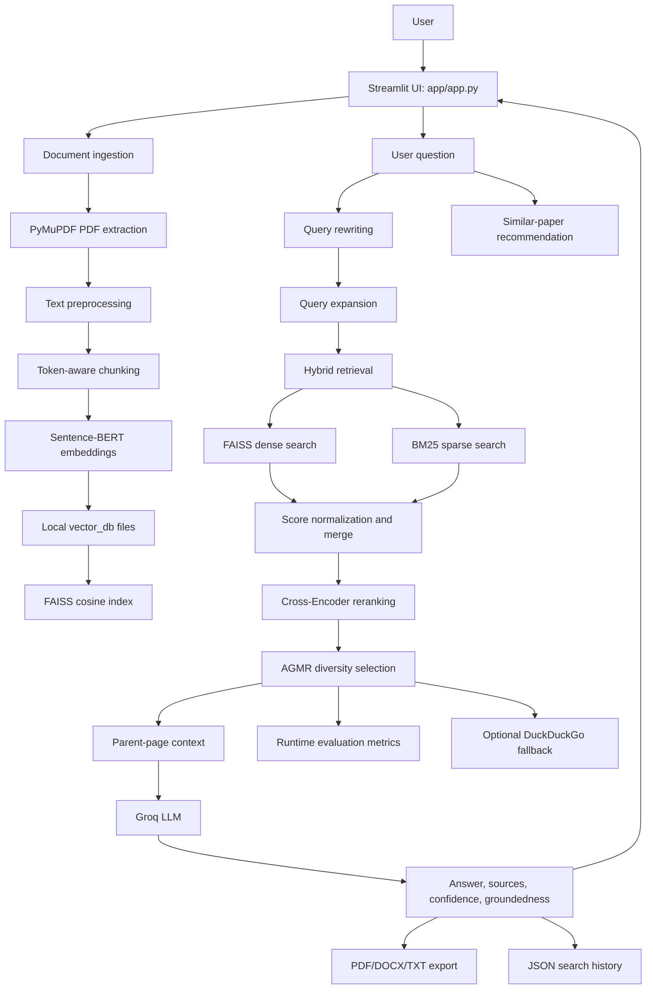

# ResearchGPT Architecture and Technology Guide

## 1. Purpose

ResearchGPT is a local Streamlit application that answers questions about uploaded research papers. It uses Retrieval-Augmented Generation (RAG): relevant passages are retrieved from the user's papers and supplied to a large language model before an answer is generated.

The application is designed as an academic research assistant, not as a general web search engine. Its primary knowledge source is the collection of PDFs uploaded into `data/raw`.

## 2. High-level architecture



## 3. Complete flow from start to finish

### 3.1 Application startup

The application is started with:

```bash
python -m streamlit run app/app.py --server.address localhost
```

[app/app.py](app/app.py) changes the working directory to the project root, adds `src` to Python's import path, creates the required folders, and renders the Streamlit interface.

The Groq client is configured in [src/llm.py](src/llm.py). It reads `GROQ_API_KEY` from `.env`. Retrieval models are loaded lazily, so the application can open before papers have been processed.

### 3.2 Uploading papers

The user uploads PDF files through Streamlit. The files are saved in:

```text
data/raw/
```

The application uses the PDF filename as the paper identifier. This identifier is later stored with every page and chunk so that answers can cite the source paper.

### 3.3 Processing papers

Clicking **Process Papers** calls [src/pipeline.py](src/pipeline.py), which runs five stages:

1. Extract PDF text.
2. Clean the extracted text.
3. Split text into searchable chunks.
4. Generate embeddings.
5. Build the FAISS index.

#### Stage 1: PDF extraction

[src/pdf_loader.py](src/pdf_loader.py) uses PyMuPDF to read each PDF page. It preserves:

- Paper filename
- Page number
- Extracted page text

The output is written to:

```text
data/processed/
```

#### Stage 2: preprocessing

[src/preprocessing.py](src/preprocessing.py) normalizes line endings, removes tabs, reduces repeated spaces, removes excessive blank lines, and writes cleaned text to:

```text
data/chunks/
```

#### Stage 3: chunking

[src/chunking.py](src/chunking.py) uses `RecursiveCharacterTextSplitter` with a tokenizer-based length function. Each chunk keeps its paper and page metadata.

Current configuration:

```text
Chunk size: 500 tokens
Overlap:    50 tokens
```

Chunk files are stored in:

```text
embeddings/*_chunks.txt
```

#### Stage 4: embedding generation

[src/embedding.py](src/embedding.py) uses:

```text
sentence-transformers/all-MiniLM-L6-v2
```

Each chunk is converted into a 384-dimensional numerical vector. The module uses a SHA-256 text hash as an embedding-cache key, so unchanged chunks do not need to be encoded again.

Generated files:

```text
vector_db/embeddings.pkl
vector_db/metadata.pkl
vector_db/embedding_cache.pkl
```

#### Stage 5: FAISS index creation

[src/faiss_db.py](src/faiss_db.py) normalizes the vectors and creates a FAISS `IndexFlatIP` index. Inner product on normalized vectors is equivalent to cosine similarity.

The index is saved as:

```text
vector_db/research_index.faiss
```

## 4. Question-answering architecture

### 4.1 Query rewriting

When a question is very short or contains ambiguous references such as “it”, “this”, or “that method”, [src/query_rewriter.py](src/query_rewriter.py) asks the Groq model to rewrite it into a standalone question. Recent search history may be included to resolve the reference.

Example:

```text
Previous question: What is RAG?
New question: What are its limitations?
Rewritten question: What are the limitations of Retrieval-Augmented Generation?
```

### 4.2 Query expansion

[src/query_expansion.py](src/query_expansion.py) adds related terms and synonyms to improve recall. This expanded query is used for retrieval, while the original question is retained for final Cross-Encoder relevance scoring.

### 4.3 Dense retrieval

[src/dense_retriever.py](src/dense_retriever.py) embeds the question with Sentence-BERT and searches the FAISS index. It returns the most semantically similar chunks.

Dense retrieval is useful when the question and paper use different words but express the same concept.

### 4.4 Sparse retrieval

[src/bm25_retriever.py](src/bm25_retriever.py) builds a BM25 keyword index over the chunk metadata.

BM25 is useful for:

- Exact technical terms
- Names
- Acronyms
- Numbers
- Rare keywords

### 4.5 Hybrid retrieval

[src/hybrid_retriever.py](src/hybrid_retriever.py) combines dense and BM25 results. Scores are normalized and merged using a weighting parameter:

```text
alpha = 0.6
```

This gives semantic retrieval slightly more influence while retaining exact keyword matching.

Optional paper filtering is applied after retrieving a larger candidate pool, allowing users to search only selected uploaded papers.

### 4.6 Cross-Encoder reranking

[src/cross_encoder.py](src/cross_encoder.py) uses:

```text
cross-encoder/ms-marco-MiniLM-L-6-v2
```

It evaluates each `(question, chunk)` pair together and produces a more precise relevance score than comparing independent embeddings.

This stage reduces false positives from the larger hybrid candidate set.

### 4.7 AGMR selection and diversity

[src/agmr.py](src/agmr.py) performs the final retrieval selection:

1. Expand the query.
2. Retrieve candidates with dense and sparse search.
3. Rerank candidates with the Cross-Encoder.
4. Group candidate embeddings with Gaussian Mixture clustering.
5. Select a diverse set of high-quality chunks.
6. Calculate a retrieval confidence score.

The purpose of the diversity step is to avoid sending five nearly identical chunks to the LLM.

### 4.8 Parent-page context

[src/parent_retriever.py](src/parent_retriever.py) maps a selected chunk back to its original page. It supplies up to 3,000 characters of page context and removes duplicate pages.

This allows retrieval to use small precise chunks while allowing answer generation to see a wider surrounding context.

### 4.9 LLM answer generation

[src/llm.py](src/llm.py) sends the retrieved context and question to Groq.

Configured models:

```text
Primary:  openai/gpt-oss-20b
Fallback: openai/gpt-oss-120b
```

The module handles empty responses, model errors, retries, and rate-limit fallback. The generated answer includes paper-based context and source information.

The optional general-knowledge mode allows the model to answer beyond the uploaded papers, but the UI labels this content as unverified.

## 5. Technologies and how they are used

| Technology | Use in ResearchGPT |
|---|---|
| Python | Main programming language |
| Streamlit | Web interface and local application runtime |
| PyMuPDF | Extracts text and page numbers from PDFs |
| LangChain text splitters | Splits documents into recursive text chunks |
| Transformers | Provides tokenizer support |
| Sentence-Transformers | Creates semantic text embeddings |
| `all-MiniLM-L6-v2` | 384-dimensional embedding model for chunks and questions |
| FAISS | Local vector index for similarity search |
| NumPy | Vector and numerical operations |
| BM25 / `rank-bm25` | Keyword-based sparse retrieval |
| scikit-learn | Gaussian Mixture clustering used by AGMR |
| Cross-Encoder | More accurate question-to-chunk reranking |
| PyTorch | Runtime used by Sentence-Transformers and Cross-Encoder |
| Groq API | Hosts the LLM used for rewriting, answering, and summaries |
| `openai/gpt-oss-20b` | Primary Groq generation model |
| `openai/gpt-oss-120b` | Groq fallback model after rate limits or failures |
| DuckDuckGo Search | Optional low-confidence web fallback |
| ReportLab | Generates PDF answer exports |
| python-docx | Generates DOCX answer exports |
| JSON and pickle | Stores history, metadata, embeddings, and evaluation data |

## 6. Important AI and RAG concepts

### Retrieval-Augmented Generation (RAG)

RAG separates knowledge lookup from answer generation:

1. Retrieve relevant paper passages.
2. Put those passages into the LLM prompt.
3. Generate an answer grounded in the retrieved evidence.

This reduces dependence on the model's training memory and makes paper citations possible.

### BERT-family models

The project does not use the original BERT directly. It uses BERT-family models:

- `all-MiniLM-L6-v2` through Sentence-Transformers for embeddings.
- `cross-encoder/ms-marco-MiniLM-L-6-v2` for reranking.

These models are encoder models used to understand text relevance. The Groq GPT-OSS model is the generative model that writes the final answer.

### Embeddings

An embedding is a numerical representation of text. Similar meanings produce vectors that are close in vector space. ResearchGPT embeds both paper chunks and user questions, then uses FAISS to find semantically similar chunks.

### Vector search

FAISS searches the chunk vectors efficiently. Because the vectors are normalized, the index uses cosine similarity behavior: higher similarity means a better match.

### Sparse retrieval

BM25 scores exact word overlap. It complements embeddings because semantic models can miss precise names or terms, while BM25 may miss paraphrases.

### Reranking

The Cross-Encoder reads the question and candidate chunk together. It is slower than vector search but more accurate, so it is applied only to the smaller candidate set.

### AGMR

AGMR is the project's adaptive retrieval and diversity layer. It uses Gaussian Mixture clustering to select relevant chunks from different semantic groups instead of returning repetitive results.

### Groundedness

[src/grounding.py](src/grounding.py) calculates a lightweight lexical overlap score between the answer and retrieved context. It is a useful warning signal, but it is not a formal fact-checker or semantic entailment system.

## 7. Supporting features

### Paper summaries

[src/summarizer.py](src/summarizer.py) reads chunk files, limits the input size, and asks the Groq model to create a summary for each paper.

### Similar-paper recommendations

[src/recommender.py](src/recommender.py) embeds the question, searches FAISS, groups matching chunks by paper, and ranks papers by their aggregated similarity.

### Citations and source display

[src/citation.py](src/citation.py) formats paper and page metadata for display and can produce IEEE, APA, and BibTeX-style citation output.

### Search history

[src/history.py](src/history.py) stores questions, answers, sources, and timestamps locally. It is displayed in the Streamlit sidebar and history section.

### Exporting answers

[src/exporter.py](src/exporter.py) creates:

- PDF files
- DOCX files
- TXT files

Files are written to `results/`.

### Evaluation

[src/eval_harness.py](src/eval_harness.py) compares retrieval strategies using:

- Hit rate
- Mean Reciprocal Rank (MRR)
- NDCG
- Adversarial accuracy

Evaluation cases are stored in `data/eval/golden_test_cases.json`.

## 8. Project directory structure

```text
ResearchGPT/
├── app/
│   └── app.py                  Streamlit user interface and orchestration
├── src/
│   ├── pipeline.py             End-to-end document processing pipeline
│   ├── pdf_loader.py           PDF text extraction
│   ├── preprocessing.py        Text cleanup
│   ├── chunking.py             Chunk creation
│   ├── embedding.py            Embedding generation and cache
│   ├── faiss_db.py             FAISS index builder
│   ├── dense_retriever.py      Vector retrieval
│   ├── bm25_retriever.py       BM25 retrieval
│   ├── hybrid_retriever.py     Dense + sparse retrieval
│   ├── cross_encoder.py         Candidate reranking
│   ├── agmr.py                 Diversity selection and confidence
│   ├── parent_retriever.py     Page-level context expansion
│   ├── llm.py                  Groq calls and answer generation
│   ├── citation.py             Source and citation formatting
│   ├── grounding.py            Answer/context overlap scoring
│   ├── query_rewriter.py       Ambiguous-query rewriting
│   ├── query_expansion.py      Retrieval query expansion
│   ├── summarizer.py           Paper summaries
│   ├── recommender.py          Similar-paper recommendations
│   ├── history.py              Local search history
│   ├── exporter.py             PDF/DOCX/TXT exports
│   ├── report.py               Research report generation
│   └── eval_harness.py         Retrieval evaluation
├── data/
│   ├── raw/                    Uploaded PDF papers
│   ├── processed/              Extracted page text
│   ├── chunks/                 Cleaned text
│   └── eval/                   Golden evaluation questions
├── embeddings/                 Structured chunk text files
├── vector_db/                  FAISS index, vectors, metadata, cache
├── results/                    Reports and exported answers
├── requirements.txt            Python dependencies
├── .env                        Local Groq API key; do not commit
└── ARCHITECTURE_AND_TECHNOLOGY_GUIDE.md
```

## 9. External configuration

The only required external credential is:

```env
GROQ_API_KEY=your_key_here
```

Hugging Face model downloads normally work without a token, although unauthenticated downloads have lower limits. DuckDuckGo fallback search does not require an API key.

Never commit `.env` or expose the Groq key in source control.

## 10. Running the application

From the project root:

```bash
source venv/bin/activate
python -m streamlit run app/app.py --server.address localhost
```

Then open `http://localhost:8501`.

Typical user flow:

1. Upload PDF papers.
2. Click **Process Papers**.
3. Wait for extraction, chunking, embeddings, and FAISS indexing.
4. Ask a research question.
5. Review the answer, confidence, groundedness, sources, and recommendations.
6. Download the answer or research report if required.

## 11. Current design considerations

### Chunk length and embedding limit

The current chunk size is 500 tokens, while `all-MiniLM-L6-v2` has an approximately 256-token input limit. This means the embedding may not represent the entire chunk. Reducing the chunk size to roughly 250 tokens would improve alignment between chunking and embedding.

### Confidence interpretation

Confidence and groundedness are heuristics. They should be treated as indicators for review, not as guarantees of correctness.

### Local storage

The project uses files and in-memory caches instead of a database. It is appropriate for local research and demonstrations, but it does not yet provide authentication, multi-user isolation, distributed indexing, or production observability.

### External service dependency

Answer generation, query rewriting, and summaries depend on Groq availability, model access, and rate limits. The application includes a fallback model, but it still requires a valid Groq API key.

## 12. Summary

ResearchGPT is a complete local RAG pipeline for research papers:

```text
PDFs
→ extracted pages
→ cleaned text
→ overlapping chunks
→ Sentence-BERT vectors
→ FAISS + BM25 retrieval
→ hybrid ranking
→ Cross-Encoder reranking
→ AGMR diversity selection
→ parent-page context
→ Groq LLM answer
→ citations, confidence, evaluation, and exports
```

The central design idea is to use specialized components for different jobs: embeddings find semantic matches, BM25 finds exact terms, the Cross-Encoder improves relevance, AGMR improves diversity, and the Groq model turns retrieved evidence into a readable answer.
